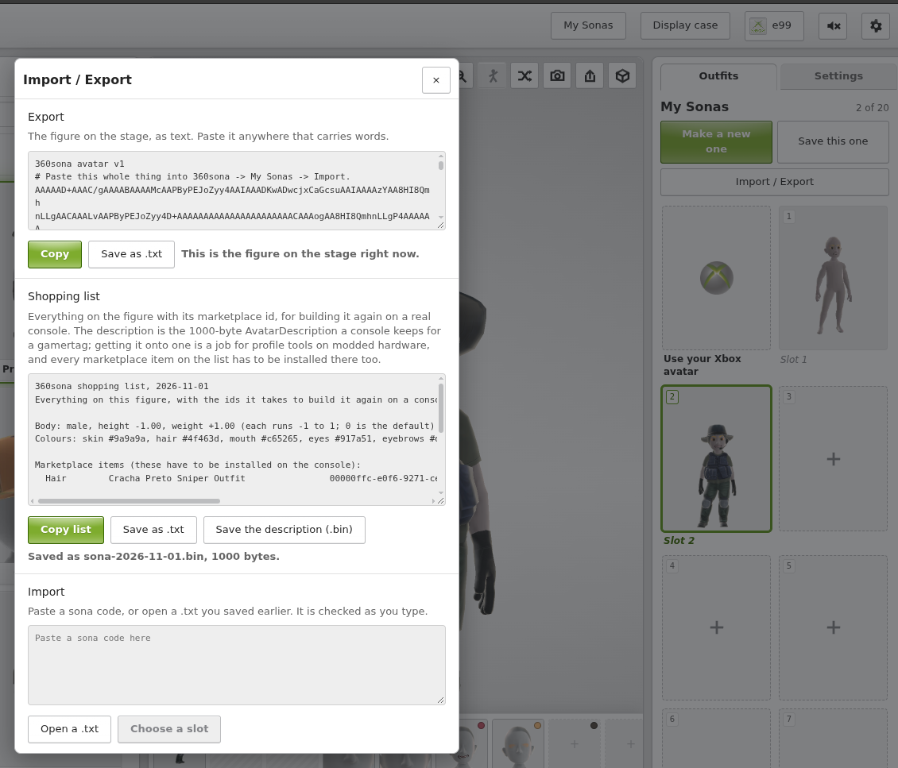

# PC setup

Play 1 vs 100 on a Windows or Linux PC against the same shows as the Xbox
360 players. You point the game at your own game files, set up your Avatar,
and start a show.

!!! tip "What you need"
    - Your own Xbox 360 and copy of the game: the untouched game package
      (used straight from `content_install`, no unpacking), or unpacked
      `default.xex` and its media. None of this is provided here.
    - Host voice lines need no copying: with the show package in
      `content_install`, the game reads `vo.xwb`/`vo.xsb` from the package.
    - For online play: the stock retail 2.0.1149.0 game files plus the show
      and episode packages — the very same files as on Xbox, see the
      [file table](game-files.md#file-table). The game files must be stock
      retail (with their original scripts), not modified ones.
    - Windows 10/11 or Linux.

!!! note "Private alpha"
    The PC build plays online on the community server, but it is still a
    private alpha: live (Primetime) mode is experimental. Expect bugs, and
    please report them on Discord.

## How you can play

- **Online on the community server** — together with Xbox 360 players, using
  the game's own online code.

## Steps

### 1. Install your game files

Put your game files where the build expects them (next to the executable, in
its `assets` folder or the folder your settings point at), or drop the
untouched game package into your `content_install` folder — with no unpacked
game folder present, the game runs straight from its own package. If anything
is missing, the game tells you on startup — re-check the list above.

### 2. Set up your Avatar with 360sona

The PC build has no Avatar creator of its own — you build your look in the
browser and export it as a file. The Avatar asset files come from Xbox 360
System Update 17559 ([CD + USB download](https://archive.org/details/xbox-360-system-update-17559-cd-usb)):
point `ONEVS100_NATIVE_AVATAR_CONTENT` (or the `native_avatar_content`
setting) at the content folder, the `AvatarAssetPack.toc` file itself, or
the `FFFE07DF00000002` package. Without it the game shows no Avatars:

1. Create an account at [360sona.com](https://360sona.com) and build your
   Sona (body, colours, clothes).
2. Open **My Sonas → Import / Export**.
3. Under *Shopping list*, click **Save the description (.bin)**. This saves a
   small file (1000 bytes, e.g. `sona-2026-11-01.bin`) — that is your
   Avatar's description, plus a list of the marketplace items it wears.
4. Copy that `.bin` file to the game's profiles folder as `avatar.bin`:
    - On Windows: `player-data\profiles\avatar.bin` (next to
      the launcher).
    - On Linux: `userdata/profiles/avatar.bin` (next to the
  executable; that is the game's default player-data folder there).



✅ **Checkpoint:** the next time the game starts, it
shows your Sona. If you see a default face instead, the `.bin` is not named
exactly `avatar.bin` or sits in the wrong folder — re-check step 4.

### 3. Go online (optional)

To play on the community server, put this in
`onevs100.toml` next to the executable:

```toml
[Online]
online_service = "gameserver"
gameserver_host = "1vs100.example.org"

[Content]
content_install = "/path/to/packages"
```

- `gameserver_host` is the server's host name or address.
- `content_install` names the game package, a show or episode package, or a
  folder of them — they are used in place when the game starts, never extracted.
- To run two copies on one PC, give each its own `guest_bind_address` (for
  example `127.0.0.1` and `127.0.0.2`).

✅ **Checkpoint:** the game reaches the lobby and joins the online show. If
it never connects, the address in `gameserver_host` is the first thing to
re-check.

---
*Avatar export steps last verified 2026-11-02.*

---
**Next:** [FAQ](faq.md) if anything goes wrong.
