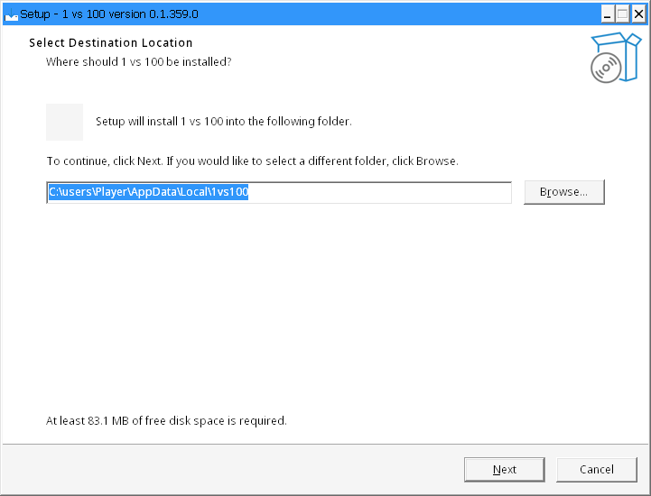
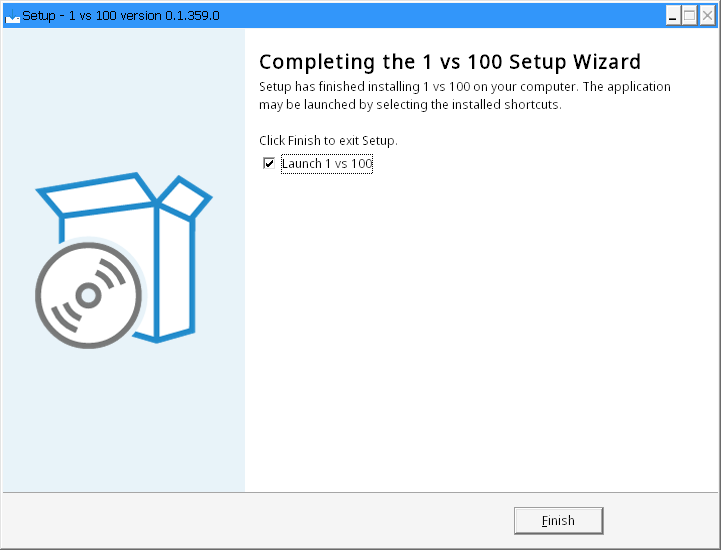
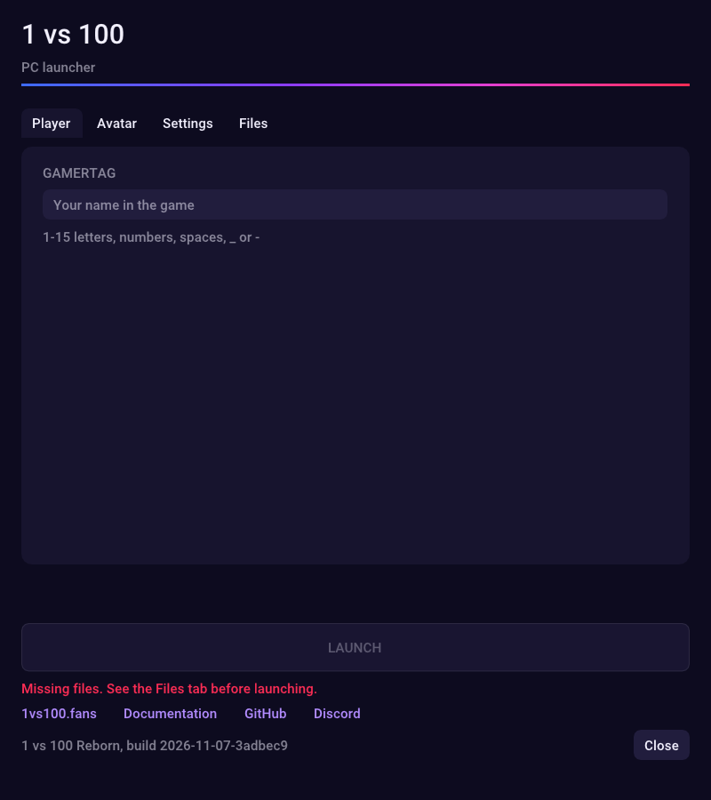
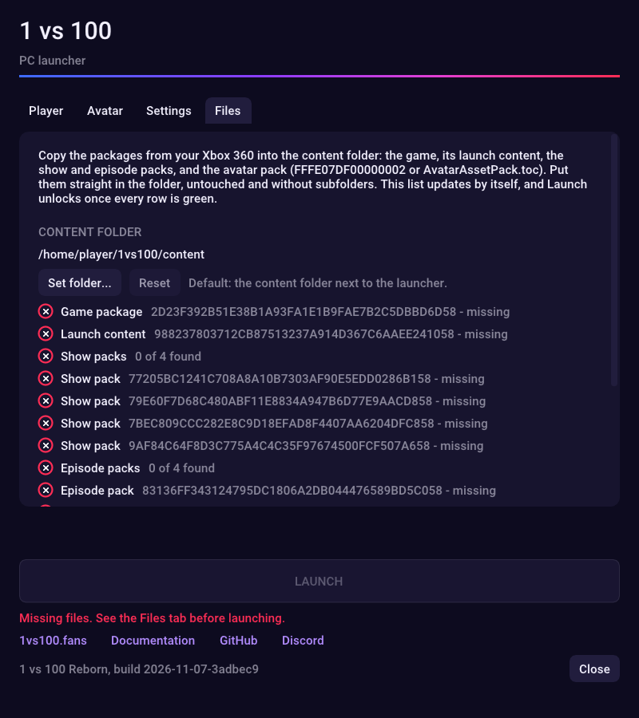
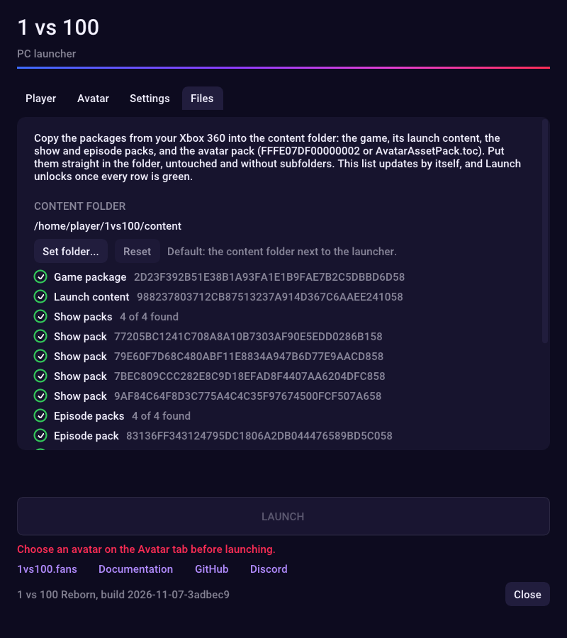
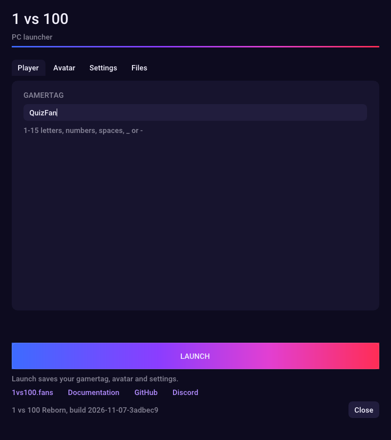
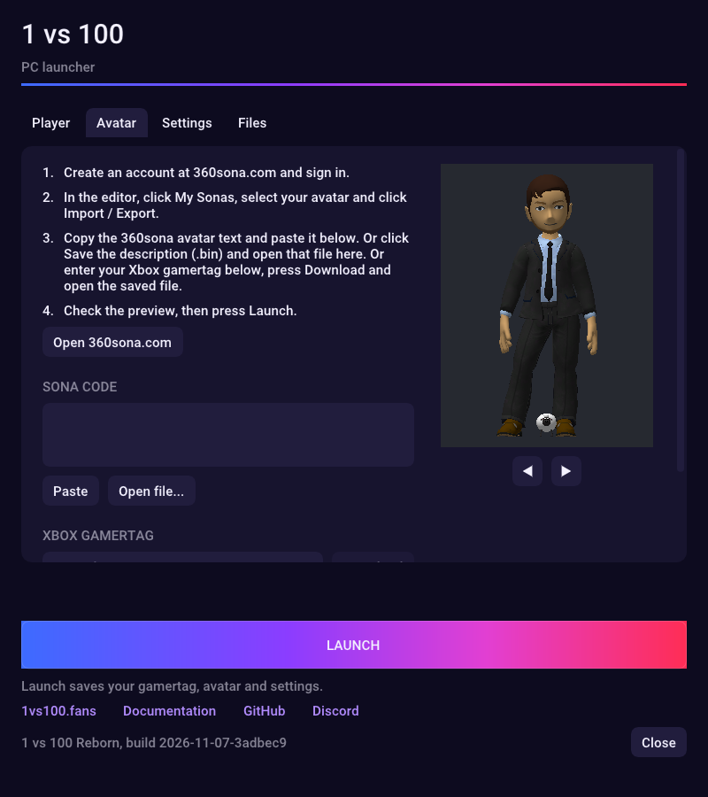
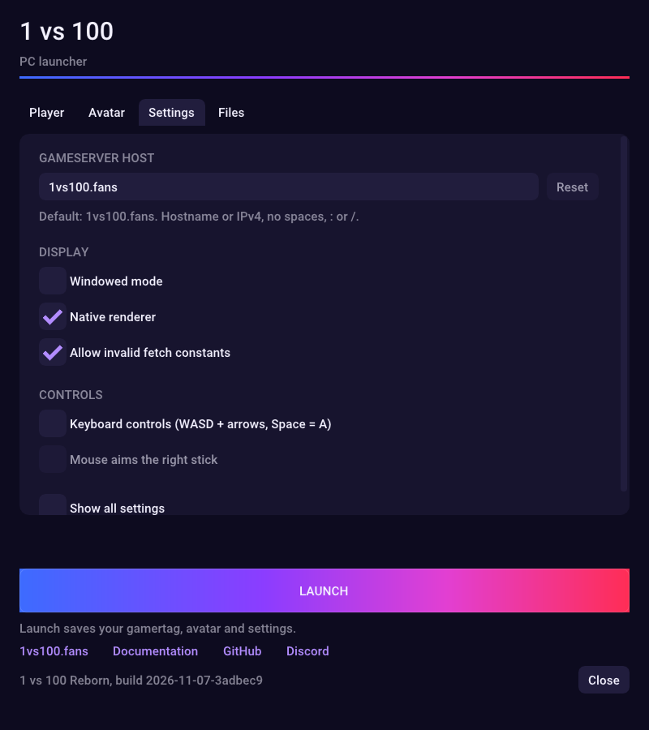
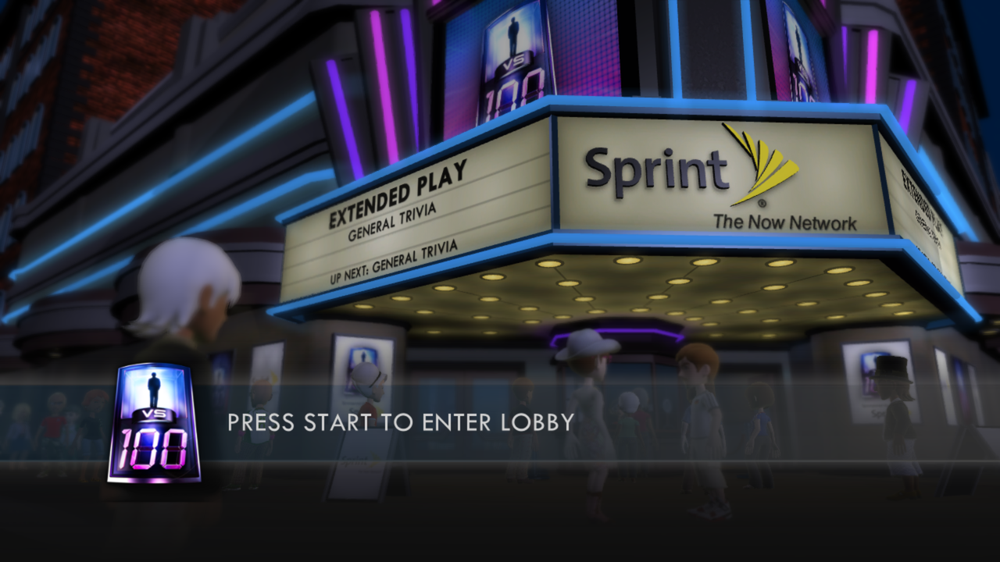

# PC setup

Play 1 vs 100 on a Windows, Linux or Mac computer, against the same shows as the Xbox players. You install the game, add your own game files, pick a gamertag and an Avatar, and press Launch. It takes about 10 minutes.

!!! tip "What you need"
    - A computer with Windows 10 or 11, Linux, or macOS 15 or newer.
    - A controller is best. A keyboard works too.
    - Your own game files: 11 files from your copy of the game. They are the same files as on Xbox, see the [file table](game-files.md#file-table). None of this is provided here.

!!! note "Early version"
    The PC version is still early. Expect bugs, and please report them on [Discord](https://discord.gg/tV3ajhwFTf).

## Steps

### 1. Download the game

Open the [download page](https://github.com/1vs100/1vs100-reborn-pc/releases/latest) and pick the file for your computer:

| Computer | File |
|---|---|
| Windows | the file ending in `-setup.exe` (recommended), or the `windows` `.zip` |
| Linux | the `linux-amd64` `.tar.xz` file (`linux-arm64` for ARM computers) |
| Mac with Apple chip (M1 and newer) | the `mac-arm64` `.zip` file |
| Mac with Intel chip | the `mac-amd64` `.zip` file |

### 2. Install it

=== "Windows installer"

    1. Open the `-setup.exe` file. If Windows shows **Windows protected your PC**, click **More info**, then **Run anyway**.
    2. Click **Next** on each page, then **Install**. The game installs into your own user folder, so you don't need to be an administrator.

        { width="480" }

    3. On the last page, leave **Launch 1 vs 100** ticked and click **Finish**.

        { width="480" }

    Later, start the game from the Start menu: **1 vs 100**.

=== "Windows zip"

    1. Unzip the file into a folder you can write to, for example `Documents\1vs100`. Not into `Program Files`: the game saves your settings next to itself.
    2. In that folder, open `launcher.exe`.

=== "Linux"

    1. Extract the `.tar.xz` file into a folder you can write to, for example your `Games` folder. You get a folder called `1vs100`.
    2. In that folder, open `launcher`.

=== "macOS"

    1. Open the `.zip` file. You get `1vs100.app`.
    2. Move `1vs100.app` out of Downloads, for example into the **Applications** folder inside your home folder.
    3. macOS blocks games from unknown developers. To allow this one, open **Terminal** once and run (adjust the path if you put the app somewhere else):

        ```
        xattr -dr com.apple.quarantine ~/Applications/1vs100.app
        ```

    4. Open `1vs100.app`.

The **launcher** opens. This is where you set everything up before you play. The **LAUNCH** button stays gray until your game files are in place.

{ width="440" }

### 3. Add your game files

1. Click the **Files** tab. It shows the **content folder** the game reads from, and every file it still needs.

    { width="440" }

2. Copy your game files into that folder: straight in, untouched, no subfolders. Or click **Set folder...** and pick the folder where your files already are. **On a Mac, use Set folder...**: the default folder is hidden inside the app.
3. The list updates by itself. When every row is green, you're done.

    { width="440" }

If a row stays red, that file is missing or is not the right one. Check it against the [file table](game-files.md#file-table).

### 4. Choose your gamertag

Click the **Player** tab and type the name other players will see: 1 to 15 letters, numbers, spaces, `_` or `-`.

{ width="440" }

### 5. Choose your Avatar

Click the **Avatar** tab. You make your Avatar on [360sona.com](https://360sona.com) (create an account and sign in), then bring it into the launcher in one of three ways:

- **Copy and paste a code.** On 360sona, click **My Sonas**, select your Avatar and click **Import / Export**. Copy the **360sona avatar** text. In the launcher, click **Paste**.
- **Open a file.** In the same **Import / Export** window on 360sona, click **Save the description (.bin)**. In the launcher, click **Open file...** and pick the saved `.bin` file.
- **Use your Xbox gamertag.** If you had an Avatar on Xbox, type your Xbox gamertag under **Xbox gamertag** and click **Download**. Save the file, then click **Open file...** and pick it.

Your Avatar shows in the preview on the right. Use the arrow buttons under it to turn it around.

{ width="440" }

### 6. Check the settings (optional)

The **Settings** tab is ready to go. The server is already set to the community server, `1vs100.fans`. You might want to change:

- **Windowed mode**: play in a window instead of full screen.
- **Keyboard controls**: play without a controller (see [Controls](#controls)).

{ width="440" }

### 7. Launch

Click **LAUNCH**. This also saves your gamertag, Avatar and settings, so next time you only press **LAUNCH**.

✅ **Checkpoint:** you see the title screen. Press **Start** (or **Enter** on the keyboard) to enter the lobby.



## Controls

Any common controller works: Xbox, PlayStation and Switch Pro controllers, and most others. Plug it in before you press **LAUNCH**.

To play with the keyboard, turn on **Keyboard controls** in the **Settings** tab first:

| Controller | Keyboard |
|---|---|
| Left stick | `W` `A` `S` `D` |
| Right stick | arrow keys |
| A / B | `Space` / `Backspace` |
| X / Y | `L` / `P` |
| Start / Back | `Enter` / `Tab` |
| LB / RB | `1` / `3` |
| LT / RT | `Q` / `E` |
| D-pad | `Shift` + arrow keys |

## If something goes wrong

- **LAUNCH stays gray.** Open the **Files** tab: a red row shows which file is missing. If all files are green, open the **Avatar** tab and choose an Avatar.
- **Nothing happens after LAUNCH, or the game closes.** The game shows a message that names a log file. Post that file on [Discord](https://discord.gg/tV3ajhwFTf).
- **The game shows no Avatars.** The Avatar pack is missing: `FFFE07DF00000002` or `AvatarAssetPack.toc` must be with your other game files.
- **The game never connects.** Open the **Settings** tab and click **Reset** next to the server, so it says `1vs100.fans`.

Still stuck? Ask on [Discord](https://discord.gg/tV3ajhwFTf).

---
**Next:** [FAQ](faq.md) if anything goes wrong.
