# Xbox One / Xbox Series setup

Play 1 vs 100 on an Xbox One or Xbox Series console, against the same shows as the Xbox 360 and PC players. You install the game from your PC's web browser, then send it your game files. It takes about 15 minutes once your console is in Dev Mode.

!!! tip "What you need"
    - An Xbox One or Xbox Series console in **Dev Mode**. See step 1.
    - A PC on the same network as the console, with a web browser. A phone helps too, but is not required.
    - Two files:
        - the game app, a file ending in `.appx`, from the [download page](https://github.com/1vs100/1vs100-reborn-pc/releases/latest)
        - [`Microsoft.VCLibs.x64.14.00.appx`](https://github.com/1vs100/1vs100-reborn-pc/releases/latest/download/Microsoft.VCLibs.x64.14.00.appx), a small Microsoft helper the game needs
    - Your own game files: 11 files from your copy of the game. They are the same files as on Xbox 360 and PC, see the [file table](game-files.md#file-table). None of this is provided here.

## Steps

### 1. Put your console in Dev Mode

Dev Mode lets your console run games that are not from the Store. Microsoft explains how to turn it on in [Xbox Dev Mode activation](https://learn.microsoft.com/en-us/windows/uwp/xbox-apps/devkit-activation). You need a Microsoft developer account for this.

When it is done, your console starts into **Dev Home**, the Dev Mode home screen.

### 2. Find your console's address

In Dev Home, look at the **Remote Access** box. It shows an address like `https://10.0.0.77:11443`. Write it down.

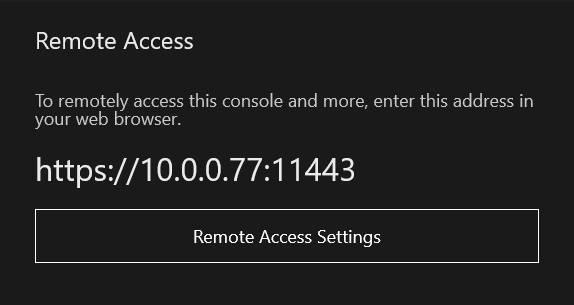{ width="380" }

If the box shows no address, select **Remote Access Settings** and turn on **Enable Xbox Device Portal**.

### 3. Open the Device Portal on your PC

Type the address into your PC's web browser. Your browser may warn you that the connection is not private. That is expected here: click **Advanced**, then **Continue** (the words differ a little between browsers).

You now see the **Xbox Device Portal**, a web page for managing your console.

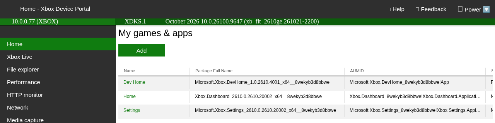

### 4. Install the game

1. Under **My games & apps**, click **Add**.
2. Click **Choose File** and pick the game app (the `.appx` file). Click **Next**.

    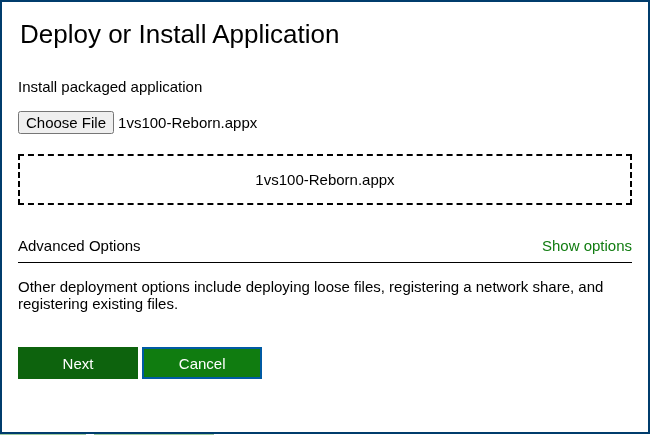{ width="460" }

3. The next page asks for dependencies. Click **Choose File** and pick [`Microsoft.VCLibs.x64.14.00.appx`](https://github.com/1vs100/1vs100-reborn-pc/releases/latest/download/Microsoft.VCLibs.x64.14.00.appx). It appears in the list below.

    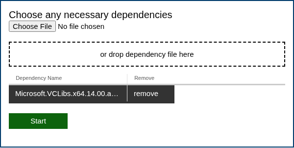{ width="440" }

4. Click **Start** and wait. Installing takes a minute or two.

✅ **Checkpoint:** **1 vs 100** now shows in the list.

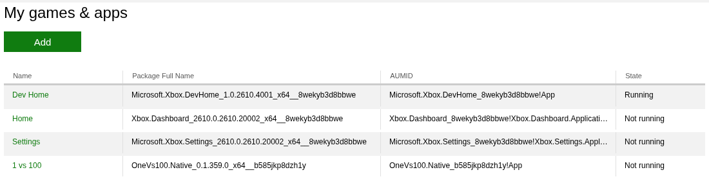

### 5. Make it a game

Your console treats new installs as apps, which get only a small part of the console's power. Switch it to a game so it runs smoothly. You do this once, on the console:

1. In Dev Home, go down to **Games and apps** and highlight **1 vs 100**.
2. Press the **View** button (the small button with two squares) and choose **View details**.

    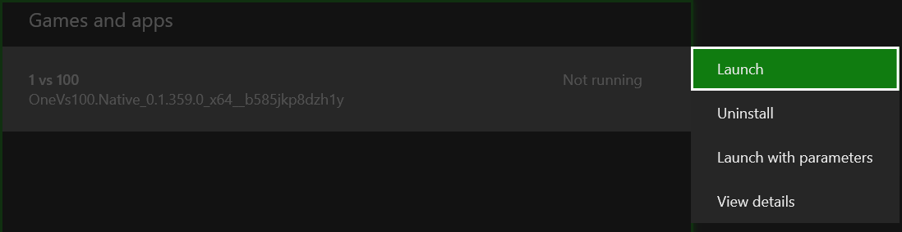{ width="620" }

3. Set **App type** to **Game**.

    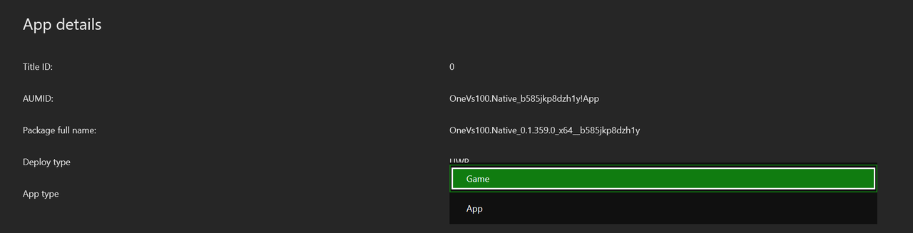{ width="720" }

4. Press **B** to go back.

### 6. Start the game

Highlight **1 vs 100**, press **View** and choose **Launch**.

The first time, the game asks for your game files.

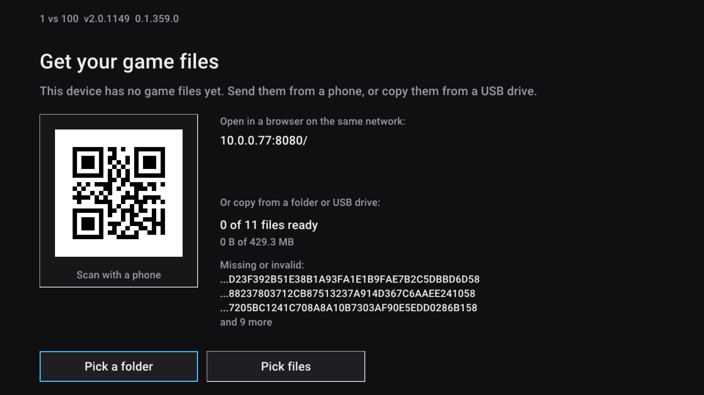

### 7. Send your game files

The easiest way is from your PC or phone:

1. Scan the QR code with your phone, or type the address shown on the screen (like `10.0.0.77:8080`) into your PC's browser.
2. Click **Choose files** and select all your game files, or **Choose folder** if they are in one folder.

    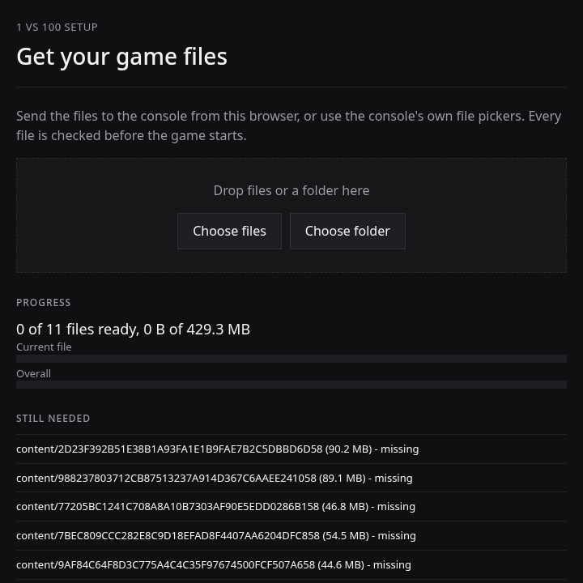{ width="440" }

3. Wait until the page says **Nothing. All files are on the console.**

    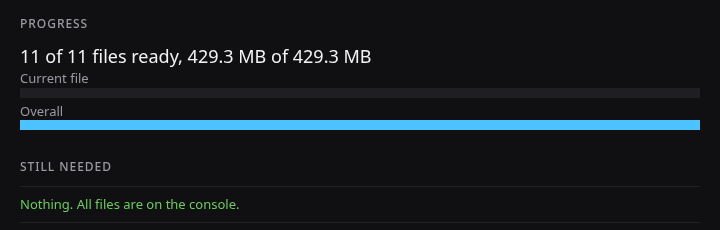{ width="480" }

The game checks every file. A file that is not the right one shows as invalid and is not used. Check it against the [file table](game-files.md#file-table).

If your files are on a USB drive, plug it into the console and use **Pick a folder** or **Pick files** on the console instead.

When the console shows **Everything is ready**, press **Continue**. You only do this once: next time the game starts straight away.

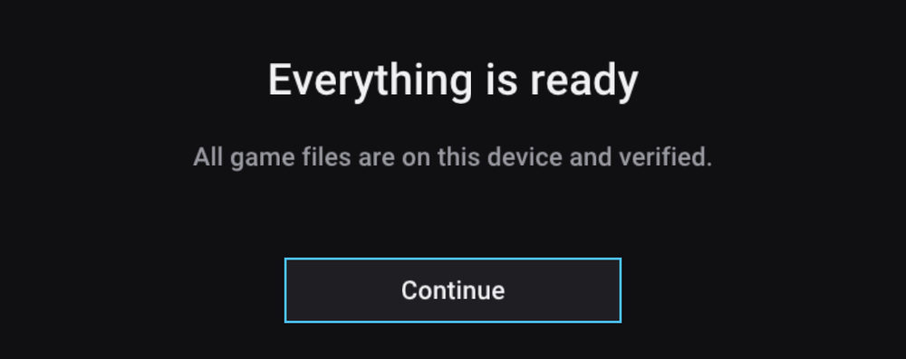{ width="560" }

✅ **Checkpoint:** you see the title screen. Press **Start** (the **Menu** button) to enter the lobby.

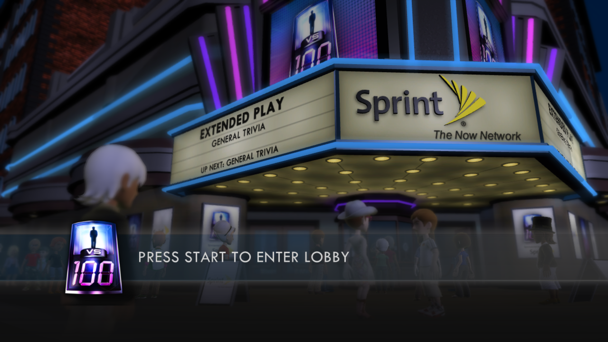

## Optional: use your own Avatar

The game shows a default Avatar until you give it yours.

1. In the game, press **View** and **Menu** together. The **Avatar** window opens.

    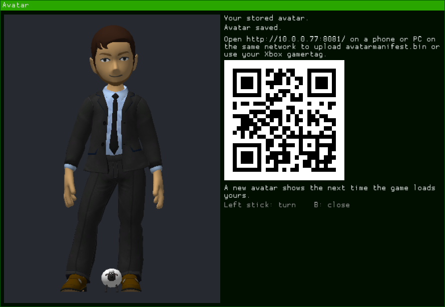{ width="560" }

2. Scan the QR code with your phone, or type the address shown (like `10.0.0.77:8081`) into your PC's browser.
3. Follow the steps on the page. You can paste a code from [360sona.com](https://360sona.com), upload your saved `.bin` file, or enter your Xbox gamertag.

    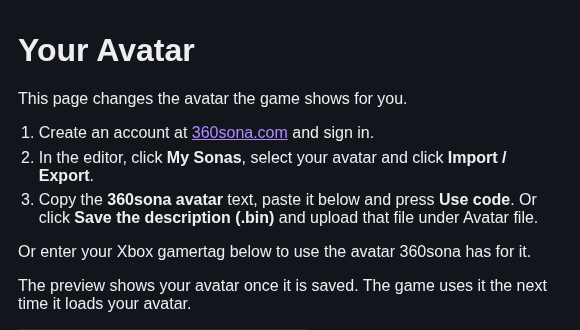{ width="460" }

4. The page says **Avatar saved** and the Avatar window shows your Avatar. Press **B** to close the window.

## If something goes wrong

- **The install stops with an error about a missing package.** Install again and add `Microsoft.VCLibs.x64.14.00.appx` on the dependencies page.
- **The setup screen keeps a file as missing or invalid.** That file is not the right one. Find another copy and check it against the [file table](game-files.md#file-table).
- **The game is slow or stutters.** Check that **App type** is set to **Game** (step 5).

Still stuck? Ask on [Discord](https://discord.gg/tV3ajhwFTf).

---
**Next:** [FAQ](faq.md) if anything goes wrong.
